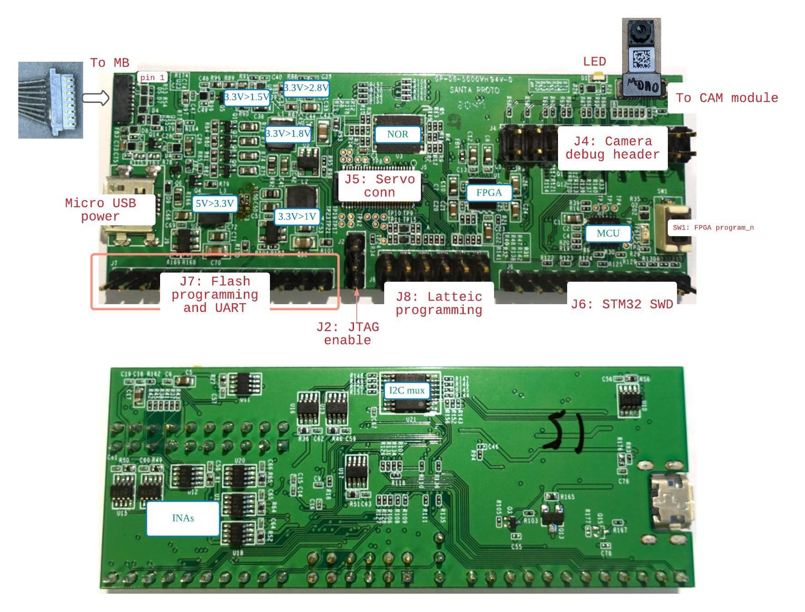

# FPGA SoC build and program

## Simulation - no hardware needed

To simulate the SoC on your local machine (no HPS hardware needed), run:

```bash
./scripts/pyrun -m soc.simulate
```

The simulator is slow while running but very quick to start, so useful for
testing many kinds of code changes.


## Connect proto0 via FTDI 3.3/1.8V board

To program the FPGA, connect the following pins:

FTDI Board | Signal   | proto0
-----------|----------|---------
A1         |  CLK     | J7-2
A2         |  COPI    | J7-3
A3         |  CIPO    | J7-4
A4         |  CS      | J7-1
A8         | PROGRAMN | J7-7
1.8V in    |  1.8V    | J7-10
GND in     |  Ground  | J7-11

You may also want to connect a UART to the FPGA. The following table shows
how to connect the FTDI board, though you may be better off using a dedicated
UART for this.

FTDI Board | Signal          | proto0
-----------|-----------------|---------
B1         | Host Tx, DUT Rx | J6-2
B2         | DUT Tx, Host Rx | J6-1

You will also need to power the board via the MicroUSB connector.




## Running On Device

To build the bitstream and software, then program the device:
```bash
./scripts/soc-load --build
```

Finally, connect a UART and communicate with the running program:

```bash
./scripts/term /dev/ttyUSB0
```
(replace `/dev/ttyUSB0` with the appropriate device name)

